# CYD MTG Table Companion

**English** | [Português (Brasil)](README.pt-BR.md)

**Tokens, life totals, commander damage, and dice for your Magic table, all on a 2.8-inch touchscreen. No phone, Wi-Fi, or account needed during play.**

<p align="center">
  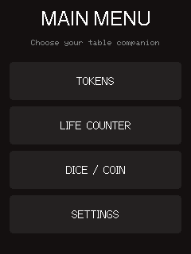
  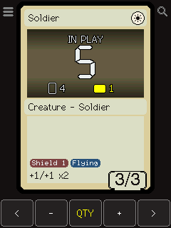
  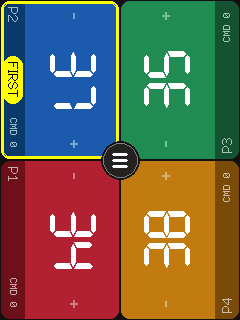
  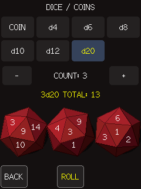
</p>

An offline Magic: The Gathering table companion for the cheap **CYD ESP32-2432S028R** ("Cheap Yellow Display") board, formerly *CYD MTG Token Tracker*. Flash it once and leave it on the table:

- **Token board**: 455 tokens from every Commander precon, plus your own custom token. Track how many are in play, how many are tapped, counters, and power/toughness.
- **Decks and precons**: import the tokens of any of **198 Commander precons** with one tap, or build up to eight decks of your own.
- **Life counter**: big, colorful panels for **1 to 8 players**, each facing its seat, with commander damage (partners included) and a random "who starts?" pick.
- **3D dice and coins**: d4 to d20 and coins, up to 20 at a time, with a tumbling 3D toss.
- **Doodles**: draw moustaches (or anything else) on your tokens.
- **Everything is saved** between sessions: tokens, counters, decks, settings, and optionally the match in progress.

[Screenshots](#screenshots) · [Getting started](#getting-started) · [How to play](#how-to-play) · [Tokens](#controls) · [Life counter](#life-and-commander-damage) · [Dice](#dice-and-coins) · [Settings](#settings) · [Troubleshooting](#troubleshooting) · [For developers](#token-catalog)

## Screenshots

*Captured from a real CYD with `tools/screenshot.py`. Official token artwork is not distributed with this project, so the cards here show the plain placeholder; with [artwork](#artwork), the illustration appears in that space.*

**Tokens**

| Token card | Choose a token | Search |
| :---: | :---: | :---: |
|  | 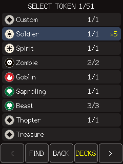 | 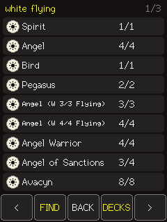 |
| Quantity, tapped copies, counters | 455 tokens, page by page | Type `white flying`, get flyers |

| Counters | Token menu | Doodles |
| :---: | :---: | :---: |
| 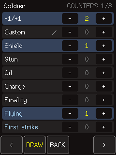 | 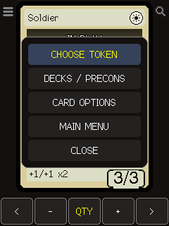 | 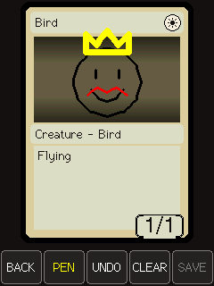 |
| +1/+1, Shield, keywords, and more | Everything about tokens in one place | Draw on any token |

**Decks**

| Your decks | Commander precons |
| :---: | :---: |
| 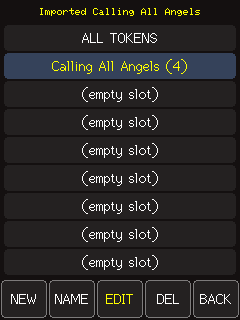 | 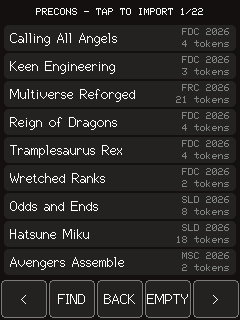 |
| Eight decks plus All tokens | One tap imports a precon's tokens |

**Life, dice, and coins**

| Life counter | Commander damage | Life menu |
| :---: | :---: | :---: |
|  | 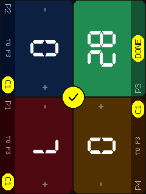 | 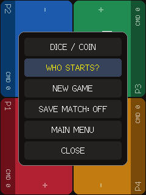 |
| Tap the left half for -1, right for +1 | Track damage from each commander | Who starts, new game, and more |

| Dice | Coins |
| :---: | :---: |
|  | 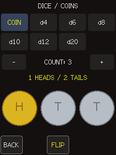 |
| d4 to d20, up to 20 at once | Heads and tails, counted for you |

**Looks and settings**

| Overlay layout | Card only layout | Card options |
| :---: | :---: | :---: |
| 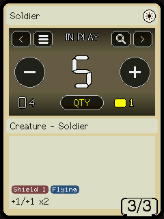 | 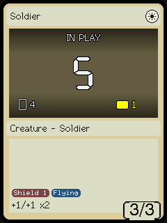 | 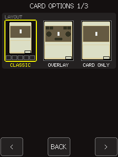 |
| Bigger buttons on the art | Just the card, controls hide | Pick your layout |

## Getting started

### What you need

- A **CYD ESP32-2432S028R** board (the one with a 2.8-inch **ILI9341** screen and **XPT2046** touch). Other CYD variants may use a different screen or pins.
- A USB **data** cable (some cables only charge).
- A computer with [VS Code and PlatformIO](https://platformio.org/install/ide?install=vscode).
- Optional: a microSD card, for sharper token artwork or for saving doodles.

### Install the firmware

1. Download or clone this repository and open the folder in VS Code.
2. Plug in the board. If it is not on **COM7**, change `upload_port` and `monitor_port` in [platformio.ini](platformio.ini) to your board's port.
3. Click **PlatformIO: Upload** (the arrow in the bottom status bar). The first build takes a few minutes.

That's it: the board restarts into the main menu. Prefer the command line? From the project folder:

```console
pio run -e esp32dev -t upload
```

On Windows **Command Prompt**, if `pio` is not on your PATH:

```bat
"%USERPROFILE%\.platformio\penv\Scripts\pio.exe" run -e esp32dev -t upload
```

> **Token artwork is optional.** The repository does not include official card art. Without it, tokens show a plain colored area; to add the illustrations, [generate the artwork](#regenerating-the-catalog-and-artwork) before building or [copy it to a microSD card](#high-quality-artwork-on-microsd).
>
> **Updating?** Just upload again: your tokens, decks, and settings are kept. Do not run `erase_flash`.

## How to play

The board starts at the **MAIN MENU**. Pick a mode; you can switch at any time without losing tokens or the current game. **BACK** always goes one step back, and **MAIN MENU** in each mode's menu brings you home.

**Tokens**

1. Tap **TOKENS**. Tap the card's **name** to pick a token (or the **magnifying glass** to search).
2. Use **+** and **-** to change how many are in play. The middle button switches between quantity (`QTY`), tapped copies (`TAP`), and power/toughness bonuses (`POW`, `TGH`).
3. Tap the **artwork** to tap or untap them all.
4. Tap the **rules text** to add counters such as +1/+1, Shield, or Flying.
5. Tap the **menu icon** for decks, precons, card options, and the main menu.

**Playing a precon?** Menu icon → **DECKS / PRECONS** → **NEW**, then tap your precon. Now the card only cycles through that deck's tokens.

**Life**

1. Tap **LIFE COUNTER**. Seat everyone around the board: each panel faces its player.
2. Tap the **left half** of a panel for **-1** and the **right half** for **+1**; hold to go faster.
3. Tap a player's **name strip** to record commander damage dealt to them.
4. The round button in the middle opens **WHO STARTS?**, **NEW GAME** (players and starting life), dice, and more.

**Dice and coins**

Tap **DICE / COIN** in the main menu or the life menu, choose the die and how many, and tap **ROLL**.

**Display looks washed out?** **SETTINGS** in the main menu has brightness, screen timeout, orientation, and gamma. Card-specific looks (layout, tone, doodles) are in **CARD OPTIONS** in the token menu.

## Hardware

| Component | Bus | Configured pins |
| --- | --- | --- |
| ILI9341 display | HSPI | SCLK 14, MISO 12, MOSI 13, CS 15, DC 2 |
| Backlight | LEDC / PWM | GPIO 21 |
| XPT2046 touch | VSPI | SCLK 25, MISO 39, MOSI 32, CS 33, IRQ 36 |
| microSD slot | VSPI, shared peripheral with touch | SCLK 18, MISO 19, MOSI 23, CS 5 |

The firmware switches VSPI pins around SD accesses, then restores the touch pins. Brightness is controlled directly by `BACKLIGHT_PIN` in [src/main.cpp](src/main.cpp); `TFT_BL` is intentionally not defined so TFT_eSPI does not control it.

## Controls

The token is displayed as a portrait card. The **Classic** layout (the default) has a bottom bar with these buttons:

- **<** / **>**: previous / next token.
- Center button: switches what **-** and **+** edit: `QTY` (in-play quantity), `TAP` (number tapped), `POW`, and `TGH` (power/toughness modifiers, creatures only). In `QTY` mode, tap the untapped or tapped icon group on the artwork to choose which copies **+ / -** will add or remove; the selected group is highlighted. The current mode is shown on the button. Counters (+1/+1 and others) are on the **counters** screen below.
- Tap the artwork to tap all untapped tokens, or untap all if they are already all tapped.
- Tap the name bar to open the paginated token list. Tap a name to select it; **<** / **>** change pages, **FIND** opens search, **BACK** returns to the card, and **DECKS** opens your [token decks](#token-decks).
- The menu icon at the upper-left edge beside the card opens the **token menu** (**CHOOSE TOKEN**, **DECKS / PRECONS**, **CARD OPTIONS**, **MAIN MENU**, **CLOSE**; tap outside it to close), and the magnifying glass at the upper-right edge opens **search**. In the other layouts, both icons are between the buttons over the artwork.

The untapped/tapped groups remain visible in every mode whenever at least one copy is in play. At zero copies, **Card Only** hides both groups; returning to `QTY`, using **+ / -**, or selecting a group reveals or keeps them visible for 2 seconds. This lets you choose how the first copy enters without leaving icons on an empty table. Classic and Overlay keep the empty groups visible in `QTY`. "IN PLAY" and the quantity appear when more than one token is in play; with 0 or 1, the quantity flashes for 2 seconds after a quantity interaction, then disappears to keep the artwork clear. The selected group determines whether **+ / -** adds or removes tapped or untapped copies. The position indicator (for example, `1/76`) appears briefly when changing tokens, then disappears. The mana icon beside the name indicates the color: sun (white), drop (blue), skull (black), flame (red), tree (green), five colored dots (multicolor), and diamond (colorless). The same icons appear in the list and the editor's color selector.

The first item in the list, `Custom`, is an editable token. With it selected, tap the lower part of the card (type and text) to open the editor for its name, type line, rules text, color, and P/T. Text fields use an on-screen keyboard, and **SAVE** stores the token in flash.

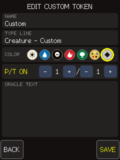

Displayed P/T already includes counters and modifiers. Tokens without P/T (such as artifacts) only let you edit quantity and tapped status.

Tokens with variable P/T preserve their printed symbols (`*/*`, `*/1+*`, etc.) instead of displaying them as 0/0. Their modifiers appear beside the symbols; the token board does not know about graveyards, and it does not read the life counter's totals, so it cannot resolve those abilities by itself. Cragflame is an Equipment: its text appears on the card, but equipping it and applying its bonus to another creature remain manual actions.

## Doodle mode

Moustaches welcome. **Hold the artwork for about a second**, or open **Counters** and tap **DRAW**, to decorate the selected token. Page 3 of **CARD OPTIONS** chooses [how drawing starts, where ink goes, and where it is saved](#card-options-page-3-doodles).

 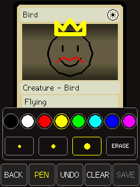

The complete card fits above a separate toolbar, so you can draw without touching game controls. With **DOODLE AREA** set to `WHOLE CARD` (the default) you can draw across the artwork, name, frame, and rules; with `ART ONLY`, ink stays on the artwork and anything already drawn outside it is hidden (not deleted) until you switch back. While drawing, quantity and tap overlays are hidden; game values are not changed. Outside drawing mode, ink remains visible in all three layouts and normal touch actions still work.

| Button | Action |
| --- | --- |
| **BACK** | Return to the card, retaining this token's ink for the current session |
| **PEN** | Open a pop-up over the canvas with eight colors, three brush sizes, and the **ERASE** tool. One tap picks and closes it; tap anywhere else (or **PEN** again) to close without changes. The button reads **ERASE** while the eraser is on |
| **UNDO** | Remove the most recent complete stroke; a single tap also counts as a stroke |
| **CLEAR** | Confirm clearing this token's current drawing |
| **SAVE** | Keep this drawing after a restart, in flash or on the microSD card (see **SAVE DOODLES TO**) |

**Eraser:** with **ERASE** selected, touch any stroke to remove that whole stroke (the topmost one under your finger); drag to erase several. Picking a color or brush returns to the pen.

**Temporary and saved drawings are both supported.** Each token, including `Custom`, has its own drawing. Switching tokens does not discard session ink. Restarting drops unsaved edits and restores the last explicitly saved version, if one exists. Clearing and erasing are also temporary until you press **SAVE**: save an empty drawing to remove its stored version.

Where **SAVE** writes depends on **SAVE DOODLES TO**:

| Option | Where | Notes |
| --- | --- | --- |
| `RAM` | Nowhere | Doodles last until the board restarts; **SAVE** only explains this |
| `FLASH` (default) | 768 KiB `spiffs` partition, LittleFS | No card needed |
| `SD CARD` | `/doodles` folder on the microSD | The card must be in the slot when the board starts |

Changing this option reads saved drawings from the new place; unsaved session ink stays on screen and can be saved there.

On the first flash save, if drawing storage is not mounted, the firmware asks before initializing it. **INIT formats only the separate 768 KiB drawing partition** (the partition named `spiffs`, used here with LittleFS), never token-save NVS or the microSD. Cancel to keep drawing temporarily. If a previously working filesystem becomes unavailable, initialization will erase drawings in that partition: cancel if you need to recover them. A damaged drawing file is reported rather than silently overwritten; use **CLEAR** to explicitly replace it.

Drawings use compact strokes rather than full-screen bitmaps. Each token is limited to **1,024 sampled points**, with a **32 KiB point-buffer budget** shared by the session; unchanged saved drawings can be unloaded and read back as needed, but unsaved ink is never silently evicted. A full drawing, exhausted RAM, or failed save produces a message in the pen-tools screen and serial log. A failed save retains the previous stored drawing.

Ink is reprojected between layouts, keeping artwork strokes anchored to the artwork; text and frame proportions may differ slightly. Compatible append-only catalog expansions retain saved drawings. Reordered or changed catalog prefixes do not reuse them for another token. Avoid `uploadfs`, which would replace the drawing filesystem.

*Tip: the resistive touchscreen works with a fingernail, but a stylus makes small details much easier.*

## Counters

Tap the card's text box (for `Custom`, tap the lower part where the seals appear) to open the counters screen. Each row has **-** and **+**; **<** / **>** change pages, and **BACK** returns to the card.

- `+1/+1` (creatures only): below zero, it becomes `-1/-1`. The total appears in the status line beside P/T and is included in the displayed P/T.
- `Custom`: one freely named counter per token. Tap its name (the one with the pencil) to rename it with the on-screen keyboard, up to 10 characters.
- Common counters: Shield, Stun, Oil, Charge, and Finality.
- Ability counters (blue): Flying, First strike, Double strike, Deathtouch, Lifelink, Trample, Vigilance, Menace, Reach, Hexproof, and Indestructible.

On the card, counters other than +1/+1 appear as seals at the bottom of the text box (above the status line on creatures). Ability counters show their number only when greater than one. If not all counters fit, their names are abbreviated and the remaining ones are shown as `+N`.

### Ygra's Food

For creatures, the last row on the counters screen is `Food (Ygra)`. **+** enables the marker and **-** removes it (0/1). It applies to all copies of that token, including copies added later, until removed. It does not create a separate Food token or remove the original types.

The marked creature gains `Artifact` and `Food` on its type line and a `Food (Ygra)` seal. It counts once for bonuses that count artifacts/Foods (for example, Construct) and appears in those searches. The marker is saved across restarts. Remove it when Ygra's effect no longer applies. The Food cost (`2, T, sacrifice: gain 3 life`) and sacrificing/gaining life are still handled manually during the game; the token board does not link to the life counter, so adjust life there yourself.

## Automatic bonuses and rules limits

Tokens with rules text like "gets +1/+1 for each [other] TYPE you control" have their P/T calculated automatically, counting tokens of that type in play across the tracker (from each token's type line):

- `Rat (Vren)`: +1/+1 for each *other* Rat (both Vren's Rats and regular Rats).
- `Construct`: +1/+1 for each artifact, including itself (Treasure, Clue, Food, etc. count).

The current bonus appears as a green seal (for example, `Rats +4/+4`) and is included in P/T. For non-token permanents (Vren himself, actual artifacts), use the `Rat cards` / `Artifact cards` row on that token's counters screen. At quantity 0, the displayed P/T is what the token would have as it enters. Role and Aura abilities are not calculated. `Custom` is also checked, so a custom creature with this text works the same way.

> **A table companion, not a full rules engine.** Rin and Seri's Cat/Dog tokens and Mabel's Cragflame are in the catalog, but triggered abilities, equipping, sacrifices, life changes from token effects, and external game zones still require player input. The Ygra marker is manual; it does not detect Ygra entering or leaving the battlefield.

## Artwork

Each token displays the illustration from its Scryfall printing, with the artist's name at the bottom of the card. Artwork is generated by `tools/fetch_tokens.py` into `src/token_art_generated.h` (up to 2.5 MB) and is excluded from version control because it is Wizards of the Coast intellectual property. Without this file, the firmware still compiles, using frame colors instead of artwork.

To fit more than 450 tokens in flash, each token stores a single JPEG at the artwork size used by the full-screen layouts (214x128, 4:2:0 color). The Classic layout scales this image on the board to 164x96. The generator lowers JPEG quality in steps of 5 only as much as needed to fit everything; the selected quality is recorded at the top of `src/token_art_generated.h`. Original quality (85) for every token would require 4 to 8 MB, more than the board's 4 MB of flash.

The script adjusts images for the display: it crops them to the artwork area and darkens the midtones of very bright artwork (`ART_MAX_MEAN`), which can blow out on the CYD's TN panel. Colors on this panel also change significantly with viewing angle: when the board lies flat on the table, the card looks washed out and white cards look overexposed. For this reason, the white frame is cream (rather than the brightest white the panel can show), and **CARD TONE** (in the token menu's **CARD OPTIONS**) and **SCREEN** (on the first **SETTINGS** page) are available. If all colors (not only light ones) look overexposed, see **DISPLAY GAMMA** on the second settings page. The application has a 3 MiB partition in [partitions.csv](partitions.csv); artwork makes uploads larger and slower.

### High-quality artwork on microSD

The generator also writes every token's artwork at **JPEG quality 90, 4:4:4 color** to `sdcard/mtgart`, in both sizes. Classic uses a native-size image instead of scaling the full-screen version.

1. [Generate the catalog and artwork](#regenerating-the-catalog-and-artwork).
2. Format a microSD card as **FAT32**.
3. Copy the entire generated **`mtgart` folder** to the card's root, keeping this structure:

   ```text
   /mtgart/
     catalog.txt
     artists.txt
     full/
       0001.jpg      # 214 x 128
       ...
     classic/
       0001.jpg      # 164 x 96
       ...
   ```

4. Insert the card in the CYD and **restart**. Card detection and catalog validation happen at boot; images are read on demand. Hot-swapping is not supported.

| Settings label | Meaning / action |
| --- | --- |
| `SD HD ART` | Matching SD artwork is available; individual missing images fall back to flash |
| `SD: NO ART` | Card mounted, but the artwork catalog file is missing or unreadable; copy the folder |
| `SD: OLD ART` | Catalog ID mismatch; regenerate and replace the entire folder |
| No label | No card mounted; embedded art is used |

**No card is required.** The firmware falls back to embedded art when an SD image cannot be opened, or colored placeholders if there is no embedded art either. Generated files in `sdcard/` are excluded from version control. Use `--no-sd-art` to skip generating them.

*microSD artwork has only been tested off-device so far; please open an issue if it does not work on your board.*

Quantities, counters, modifiers, and the selected token are saved in flash (NVS) and restored when the board restarts.

## Table tools

Decks and precons belong to token mode: open them from the token menu (**DECKS / PRECONS**) or with **DECKS** in the token list. The life counter and dice have their own entries in the main menu.

### Token decks

- **DECKS** holds up to **eight named decks**, plus **ALL TOKENS**. Tap a row to activate it; **BACK** returns to the card with that deck.
- **NEW** opens the [precon list](#precon-decks) to import a deck; its **EMPTY** button creates a blank deck instead and opens the name keyboard. **NAME** renames the active deck.
- **EDIT** opens the full catalog. Tap tokens to toggle membership (`YES` means included); **FIND** searches the full catalog while editing. **BACK** returns to decks.
- **DEL** asks for confirmation and removes only that deck's filter.
- Outside editing, token navigation, search results, and the position indicator use the active deck. An empty deck returns to deck management instead of showing an unrelated token.
- Decks share artwork, quantities, tapped copies, counters, and the custom token. The same token can belong to multiple decks. Deck definitions and the active filter are always saved.

### Precon decks

- **NEW** in **DECKS** lists all **198 Commander precons** from the catalog snapshot, newest first, with set code, year, and token count. **< / >** change pages; **FIND** searches by name, set code, or year (for example `BLC`, `2024 dragons`). **EMPTY** makes a blank deck instead, and **BACK** returns to decks.
- Tap a precon to **import** it into a free deck slot and activate it. Precons already in a slot are highlighted; importing again refreshes that slot. **NEW** needs a free slot: if all eight are used, **DEL** one first.
- An imported precon is a normal deck: rename it, **EDIT** it to add or remove tokens, or delete it. Names longer than 24 characters are shortened.
- The list contains the tokens Scryfall links to the cards in each decklist. Effects that only copy permanents, or that create tokens without a linked card, may need **EDIT**.

### Life and commander damage

Open **LIFE COUNTER** from the main menu. Each of the **1-8 players** gets a colored panel turned to face their seat around the device: the first player at the bottom (or bottom-left), then clockwise up the left side and down the right; with two players, the second panel faces the top.

- Tap the **left half** of a panel for **-1** and the **right half** for **+1**. Hold to repeat; after a few repeats it steps by **10**. A yellow bubble in the panel shows the running change (`+3`, `-7`) and fades about 2.5 seconds after the last tap.
- A panel turns dark with a light-red number when that player is at **0 or less** or has taken **21** from one commander.
- The round **menu button** in the middle opens **DICE / COIN**, **WHO STARTS?** (a highlight circles the table, slows down and stops on a random player, marked `FIRST`; the next tap clears it), **NEW GAME**, **SAVE MATCH: ON / OFF**, **MAIN MENU**, and **CLOSE**. Tap outside the menu to close it.

**NEW GAME** selects player count and initial life, with **20 / 25 / 30 / 40** presets and fine adjustment from **1 to 9999**. **START** asks for confirmation before resetting all players' life and commander damage; token state is not reset. Player count and initial-life defaults are saved even when match restoration is off.

The strip at the bottom of each panel shows `P1`-`P8` and a **CMD** pill with the most damage that player has taken from a single commander. **Tap the strip** to record commander damage dealt **to** that player: the other panels darken and show how much each of them has dealt (`TO P2`); their **+ / -** halves add or remove that damage, which also adjusts the recipient's life. Tap a source's strip to switch between its **C1** and **C2** (partners); their damage is never combined for the 21 threshold. Tap the recipient's panel (`DONE`) or the check button in the middle to go back. Life supports **-9999 to 9999**, and each commander-damage entry supports **0-999**. This is manual bookkeeping, not a rules engine or automatic player elimination.

**SAVE MATCH: OFF / ON** in the life menu controls restart restoration of life and commander damage; the menu stays open so you can see the new state. It defaults to **OFF**. Turning it **ON** saves the current match immediately; later changes save after 1.5 seconds of inactivity. Turning it **OFF** removes the saved match immediately, but leaves the current match in RAM; after restarting, a fresh match uses the saved player-count and initial-life defaults. Decks and existing token saves are independent of this setting. Wait at least 1.5 seconds after edits before cutting power; storage errors appear in the table header and serial log.

### Dice and coins

**DICE / COIN** (in the main menu and the life menu) offers **COIN, d4, d6, d8, d10, d12, d20** and **1-20** rolls at a time. **ROLL** (or **FLIP** for coins), or a tap on the results area, tosses them in 3D for about a second: each die flies in, arcs toward you with a growing shadow, bounces once and tumbles to rest on its result. Dice are real flat-shaded polyhedra (tetrahedron d4, cube d6 with pips and opposite faces adding to 7, octahedron d8, kite-faced d10, dodecahedron d12, icosahedron d20) lit from the upper left; coins flip end over end, showing their edge, and land gold heads or silver tails. The sum or the heads/tails count appears above. Results remain visible during the current session, labeled with the type and count actually rolled, even if you change the next roll's options. Results are not restored after restarting. **BACK** returns to wherever dice were opened: the main menu or the life counter. Rolls use the ESP32 random generator with rejection sampling to avoid modulo bias.

## Settings

There are two settings screens, each with **<** / **>** to change pages and **BACK** to leave:

- **SETTINGS** in the main menu holds what affects the whole device: brightness, screen timeout, orientation, and gamma (two pages). **BACK** returns to the main menu.
- **CARD OPTIONS** in the token menu holds what only affects the token card: layout, card tone, and doodles (three pages). **BACK** returns to the card.

| Settings 1/2 | Settings 2/2 | Card options 2/3 | Card options 3/3 |
| :---: | :---: | :---: | :---: |
| 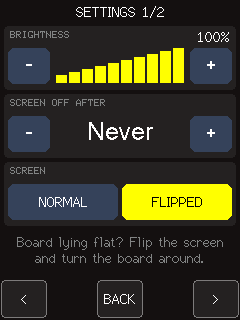 | 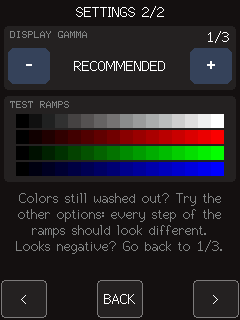 | 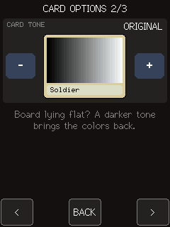 | 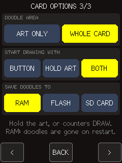 |

### Page 1: brightness, timeout, and screen

- **BRIGHTNESS**: 10 brightness levels, from 10% to 100%. Use **-** / **+** or tap the bars to jump directly to a level.
- **SCREEN OFF AFTER**: idle time before the display turns off: 15 s, 30 s, 1, 2, 5, or 10 min, or `Never` (the default). The touch that wakes the screen only turns it on; it does not activate a button.
- **SCREEN**: `NORMAL` or `FLIPPED`, which rotates the display 180 degrees (touch follows). The TN panel looks much better from one side than the other; when playing on a table, try both orientations by rotating the board.

### Page 2: display gamma

For when all colors look washed out or overexposed, not only light colors:

- **DISPLAY GAMMA**: programs the panel's gamma curve. This board needs color inversion (`TFT_INVERSION_ON`) and often starts up with the wrong gamma, making everything too bright and low-contrast. **-** / **+** switch profiles; the selected profile takes effect immediately and whenever the board powers on:
  - `RECOMMENDED` (default): the manufacturer's gamma tables, with the curve reselected just after the display turns on; this is the adjustment the TFT_eSPI community reports for this board (issue 2985).
  - `NO INVERSION`: disables color inversion. If the display becomes a negative image, return to profile 1/3.
  - `ST7789 GAMMA`: ST7789 gamma tables, used by some clone panels.
- **TEST RAMPS**: grayscale, red, green, and blue gradients from black to full intensity, rendered directly by the panel without **CARD TONE**. On a well-adjusted panel each step differs from its neighbor and the first steps are dark; if bright steps blend together or dark steps already look gray, try another profile. After setting gamma, adjust **CARD TONE** and **BRIGHTNESS** if needed.

### Card options page 1: layout

- **LAYOUT**: tap one of the thumbnails.
  - **Classic**: card with a button bar below, the menu icon on the left corner, and the magnifying glass on the right (default).
  - **Overlay**: card fills the screen and controls overlay the artwork: `<`, menu icon, magnifying glass, and `>` at the top; large **-** / **+** buttons beside the number; and the mode selector (`QTY`, `TAP`, `POW`, `TGH`) below it.
  - **Card only**: like Overlay, but controls disappear after 4 seconds without input, leaving only the card. The first touch brings the controls back without activating anything.

In full-screen layouts, tapping the artwork still taps the tokens, and tapping the name bar still opens the list.

### Card options page 2: card tone

For when the card looks bright, washed out, or overexposed, such as when the board lies flat on a table:

- **CARD TONE**: darkens the entire card (artwork, frame, text boxes, and mana icon) and lowers the white point to prevent white from blowing out: `ORIGINAL` (default) and `DARKER 1` through `DARKER 5`. The preview between **-** and **+** shows a thumbnail of the current token with the selected tone (grayscale for `Custom`). It applies to the card and layout thumbnails, but not the rest of the interface. If white still looks too bright, also reduce **BRIGHTNESS** or try **SCREEN** in **SETTINGS**.

### Card options page 3: doodles

See [Doodle mode](#doodle-mode).

- **DOODLE AREA**: `ART ONLY` keeps ink on the artwork; `WHOLE CARD` (default) also allows the name, frame, and rules. Ink drawn outside the artwork is kept while `ART ONLY` hides it.
- **START DRAWING WITH**: `BUTTON` (the **DRAW** button on the counters page), `HOLD ART` (hold the artwork for about a second), or `BOTH` (default). With a hold option, tapping the artwork taps the tokens when you lift your finger instead of when you touch it.
- **SAVE DOODLES TO**: `RAM` (nothing is saved), `FLASH` (default), or `SD CARD` (`/doodles` on the microSD). The hint below says when no card was found at startup.

Settings are saved in flash (NVS), separately from tokens, and remain in effect when the catalog changes.

## Search

The magnifying glass or **FIND** button in the token list opens an on-screen keyboard. Type a query and confirm with **OK** to show matching tokens:

- Search is case-insensitive and matches substrings (`gob` finds Goblin).
- With multiple space-separated words, every word must match, in any order (`green 3/3` finds green 3/3 tokens).
- Each word is matched against the name, type line, rules text, color name (`white`, `blue`, `black`, `red`, `green`, `multicolor`, `colorless`), and P/T (`3/3`).
- **FIND** in the list refines the search while keeping the entered text; **BACK** on the keyboard cancels. Tapping the card's name bar always opens the full list, and **<** / **>** on the card continue to cycle through all tokens.

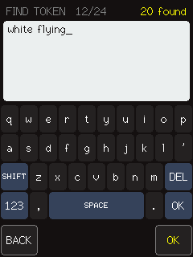 

## Troubleshooting

| Symptom | What to check |
| --- | --- |
| Upload cannot open the port | Check the USB data cable, board port, and COM7 settings; close any other serial monitor |
| No token illustration | Expected on a fresh checkout; generate artwork before building, or prepare the microSD folder |
| SD art is ignored | Check FAT32, `/mtgart/catalog.txt`, the settings label, and restart after inserting the card |
| A doodle disappears after restarting | Only **SAVE** persists ink; **BACK** keeps it for the current session. With **SAVE DOODLES TO** set to `RAM` nothing is kept |
| Tapping the artwork feels delayed | With a hold option in **START DRAWING WITH**, the tap counts when you lift your finger; choose `BUTTON` for instant taps |
| Doodles on the SD card are not found | The card must be inserted before the board starts; the drawings are in `/doodles` |
| Drawing save or load fails | Read the pen-tools message and serial log; do not initialize existing storage unless you accept erasing saved drawings |
| Colors look washed out | Try **DISPLAY GAMMA** first, then **CARD TONE**, brightness, and screen orientation |
| Buttons respond at the wrong positions | Check board revision and touch calibration below |

### Touch calibration

The initial limits in `src/main.cpp` are approximate. If buttons respond at the wrong positions, calibrate `TOUCH_X_MIN`, `TOUCH_X_MAX`, `TOUCH_Y_MIN`, and `TOUCH_Y_MAX`. If the axes are swapped, adjust the conversion of `point.x` and `point.y` in `handleTouch()`.

## Token catalog

Tokens come from `src/tokens_generated.h`, generated from the Scryfall API. Do not edit this file by hand. The generator preserves the staples at the start of `SPECS` in `tools/fetch_tokens.py` and adds tokens from precons:

- Discovers physical `Commander Deck` products in MTGJSON, including Secret Lair, up to the selected date.
- Queries the corresponding token sets in Scryfall and tokens linked to each card in those decklists. This also covers Commander 2011/2013 and other products without their own token set.
- Merges printings with the same name, types, colors, P/T, and rules text; different variants remain separate. Shared sets may add tokens not used by the decks.
- Rin and Seri have `Cat (Rin and Seri)`, **green 1/1**, and `Dog (Rin and Seri)`, **white 1/1**. The existing white Cat remains separate. `Cragflame (Mabel)` is the legendary Equipment token.
- Emblems are also included when available. This is not a list of every alternate-art printing, nor an engine that executes all Magic abilities.

The same run writes `src/precons_generated.h`: each precon's name, set code, year, and its catalog tokens for the precon list (**DECKS → NEW**). Collector's editions share the token lists of their regular decks. Its `PRECON_CATALOG_ID` must match `CATALOG_ID`, so the build fails if only one of the two files is updated.

### Regenerating the catalog and artwork

Run from the project root. Internet is required; Pillow is required for images. These commands use the PlatformIO Python on Windows Command Prompt:

```bat
"%USERPROFILE%\.platformio\penv\Scripts\python.exe" -m pip install pillow
"%USERPROFILE%\.platformio\penv\Scripts\python.exe" tools\fetch_tokens.py --as-of 2026-10-24
```

On other platforms, use `python -m pip install pillow` and `python tools/fetch_tokens.py --as-of 2026-10-24` with your Python environment.

| Option | Purpose |
| --- | --- |
| `--as-of YYYY-MM-DD` | Limit precon release dates; defaults to today. The included snapshot uses `2026-10-24` |
| `--refresh` | Refresh cached API responses |
| `--no-art` | Generate only the catalog and precon decks |
| `--no-sd-art` | Generate catalog and embedded art, but skip the microSD folder |

API data is cached in `tools/catalog_cache`; downloaded images are reused from `tools/art_cache`. Without Pillow, only the catalog is generated. The generator processes every page and fails explicitly if it cannot resolve a required entry. JPEG quality is lowered only as far as needed to fit embedded artwork in flash; SD quality stays at 90. Color/tone curves and panel gamma are not changed. Rebuild and upload after regenerating embedded art; replace the SD folder too if the catalog changed.

### Adding an entry

To add a token, add a tuple to `SPECS` in the format `(name, colors, power, toughness, text[, label])` and run the script again:

- `colors`: letters `w`, `u`, `b`, `r`, `g`, or `c` (colorless).
- `power`: `None` for tokens without P/T, such as artifacts.
- `text`: `""` requires a token with no rules text, a string requires that text to appear, and `None` accepts any text.
- `label`: display name in the list when two tokens would otherwise have the same name, such as `Wurm (Deathtouch)` and `Wurm (Lifelink)`.

### Offline tests

Table rules can be tested on a PC with a native C++11 compiler (not the ESP32 cross-compiler). For example, with GCC in Windows Command Prompt:

```bat
g++ -std=c++11 -Wall -Wextra -Werror tools\test_table_state.cpp -o "%TEMP%\test_table_state.exe"
"%TEMP%\test_table_state.exe"
```

These tests cover deck membership and wraparound, all eight players and both commanders, life adjustments and limits, the per-commander 21 threshold, save-layout validation, and die-face ranges/rejection.

Catalog-generator tests:

```bat
"%USERPROFILE%\.platformio\penv\Scripts\python.exe" -m unittest tools.test_fetch_tokens
```

### Precon coverage audit

[tools/check_precon_coverage.py](tools/check_precon_coverage.py) checks catalog coverage through a path independent of the MTGJSON decklists. It starts from Scryfall's own list of Commander products (sets of type `commander` and products with "Commander" in the name), walks every card printed in them, and verifies that every token they create (and every token in those products' token sets) is in the catalog. It also lists Commander-like decks outside the `Commander Deck` type and products without decklists. The script exits with an error if any token created by a precon card is missing. Internet is required.

```bat
"%USERPROFILE%\.platformio\penv\Scripts\python.exe" tools\check_precon_coverage.py --as-of 2026-10-24
```

<details>
<summary>Coverage audit results: 2026-10-24 snapshot</summary>

Results for the 2026-10-24 snapshot:

- 198 MTGJSON `Commander Deck` decklists, all complete (100 cards). 47 of Scryfall's 52 Commander products have decklists. The five without decklists are not precons: Commander's Arsenal, Commander Collection Green/Black, the Baldur's Gate minigames, and Mystery Booster Commander Edition. Products outside the `Commander Deck` type are digital products (MTGO 2009, Arena Historic Brawl), collector boxes, and old Starter decks.
- 21,807 printings in 54 sets, 1,187 linked tokens, and 46 token sets; 460 distinct token faces.
- **No tokens missing among those created by precon cards.** The 29 tokens absent from the catalog are only made by cards not in any precon: Secret Lair drops, Mystery Booster Commander, and collector-booster extras (Legends Retold from DMC, Realms and Relics from LTC, and Marvel/Final Fantasy/TMNT Eternal extras).
- Game designations (Dungeon, Monarch/Initiative, Ring, Boss, Event, Experience/Poison counters) are not tokens because they are not permanents.

</details>

### Updating the screenshots

The images in `docs/screenshots` are captured from a real board. The `shots` build adds serial commands that dump the screen and inject taps, and leaves out embedded artwork:

```bat
"%USERPROFILE%\.platformio\penv\Scripts\pio.exe" run -e shots -t upload
"%USERPROFILE%\.platformio\penv\Scripts\python.exe" tools\screenshot.py COM7 shot home tap 120 102 wait 800 shot token-card
"%USERPROFILE%\.platformio\penv\Scripts\pio.exe" run -e esp32dev -t upload
```

Steps are `tap X Y`, `hold X Y MS`, `path X,Y X,Y ... end` (a drag), `wait MS`, and `shot NAME` (saves `docs/screenshots/NAME.png`). Coordinates are portrait screen pixels (240x320). The capture reads the display's memory, so the PNGs have the intended colors even though this panel runs with color inversion. Reflash `esp32dev` afterward; the `shots` build is for development only.

## Saves and firmware updates

The generated file includes a `CATALOG_ID` and CRCs for list prefixes. If an expansion preserves all existing entries in the same order, quantities, selection, counters, names, and custom cards are preserved. Incompatible catalogs discard only token state, with a serial warning; `Custom` and settings remain preserved.

`partitions.csv` keeps the offsets of the application and original NVS and reserves a 128 KiB `tokenstore` NVS for the expanded catalog. Firmware automatically migrates old saves without erasing the original NVS. Flash normally with PlatformIO to update the partition table as well; do not use `erase_flash` for this update.

Table tools use a separate `table` namespace in `tokenstore`; they do not change the existing token-save format. Deck memberships survive compatible catalog extensions. If catalog entries are reordered incompatibly, deck names remain but memberships are cleared with a warning to avoid pointing at the wrong tokens.

With **SAVE DOODLES TO** set to `FLASH`, saved doodles are separate LittleFS files in the existing `spiffs` partition, not part of token NVS. Normal firmware upload preserves that partition; `uploadfs`, explicit drawing-storage initialization, or a full flash erase does not. With `SD CARD`, they are files in `/doodles` on the microSD, named by catalog prefix ID and position (`dXXXXXXXX-NNNN.bin`).

## Credits

Catalog data and image references come from [Scryfall](https://scryfall.com/) and [MTGJSON](https://mtgjson.com/). The firmware uses [TFT_eSPI](https://github.com/Bodmer/TFT_eSPI), [XPT2046_Touchscreen](https://github.com/PaulStoffregen/XPT2046_Touchscreen), and [JPEGDEC](https://github.com/bitbank2/JPEGDEC).

Magic: The Gathering and its card artwork belong to Wizards of the Coast and their respective rights holders. This is an unofficial fan project, not affiliated with or endorsed by Wizards of the Coast. Downloaded artwork is not distributed in this repository.
