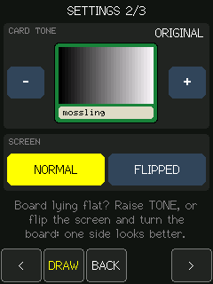
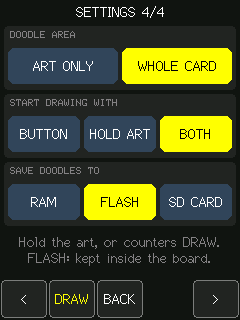

# CYD MTG Token Tracker

**Português (Brasil)** | [English](README.md)

**Seus tokens em uma tela touch de 2,8 polegadas. Sem celular, Wi-Fi ou conta durante a partida.**

Um rastreador offline de tokens de Magic: The Gathering para o **CYD ESP32-2432S028R**. Escolha os tokens, ajuste quantidades e copias viradas, adicione marcadores e mantenha tudo salvo entre as partidas.

| Em resumo | |
| --- | --- |
| **455 entradas + Custom** | Tokens e emblemas cobrindo 198 listas de precons de Commander na snapshot de 24/10/2026 |
| **Tres layouts** | Controles no Classic, Overlay em tela cheia ou Card only sem controles sobre a carta |
| **Marcadores e P/T** | +1/+1, marcadores com nome, de habilidade e bonus "para cada" reconhecidos |
| **Desenhe nos tokens** | Desenho na arte ou na carta inteira: oito cores, tres pinceis, borracha, desfazer e salvamento na RAM, flash ou microSD |
| **Busca rapida** | Nome, tipo, texto, cor e P/T pelo teclado na tela |
| **Arte opcional no microSD** | JPEGs de maior qualidade, com retorno automatico para a arte embutida |
| **Estado persistente** | Quantidades, marcadores, token personalizado e preferencias de tela salvos na flash |

[Tour da interface](#tour-da-interface) · [Inicio rapido](#inicio-rapido) · [Controles](#controles) · [Desenhos](#modo-de-desenho) · [microSD](#arte-em-alta-qualidade-no-microsd) · [Configuracoes](#configuracoes) · [Catalogo e desenvolvimento](#catalogo-de-tokens)

## Tour da interface

| Classic | Overlay | Card only |
| :---: | :---: | :---: |
|  |  |  |
| Barra de controles embaixo | Carta em tela cheia com controles | Controles somem depois de 4 segundos |

| Contadores | Busca | Editor de token |
| :---: | :---: | :---: |
|  |  |  |
| Marcadores por tipo de token | Combine cor, P/T e texto | Crie seu proprio token |

*Interface real do firmware renderizada pelo harness de testes no PC, nao fotos da tela fisica. As capturas usam um token personalizado sem arte de carta; as ilustracoes baixadas nao fazem parte do repositorio. Gama e efeitos do angulo de visao so aparecem no hardware. A interface da placa e em ingles nas duas versoes do README.*

## Inicio rapido

### 1. Confira a placa

Voce precisa de um **CYD ESP32-2432S028R**, com tela **ILI9341** e touch resistivo **XPT2046**, um cabo USB de dados e o [PlatformIO](https://platformio.org/install/ide?install=vscode) no VS Code. O microSD e opcional.

> **Confira a revisao da placa antes de gravar.** Outras variantes do CYD podem usar outro controlador de tela ou outra pinagem.

### 2. Compile e grave

Abra a pasta do projeto no VS Code. Use **PlatformIO: Build** e depois **PlatformIO: Upload**, ou execute estes comandos na raiz do projeto:

```console
pio run -e esp32dev
pio run -e esp32dev -t upload
pio device monitor -b 115200
```

No **Prompt de Comando do Windows**, se `pio` nao estiver no PATH:

```bat
"%USERPROFILE%\.platformio\penv\Scripts\pio.exe" run -e esp32dev -t upload -t monitor
```

O [platformio.ini](platformio.ini) configura as duas portas USB como **COM7**. Ajuste `upload_port` e `monitor_port` para a porta da sua placa, se necessario. Saia do monitor serial com **Ctrl+C** antes de gravar de novo.

> **Primeira compilacao:** o catalogo ja vem incluido, mas as artes nao. Voce pode gravar agora e usar fundos coloridos ou [gerar as artes](#regenerar-o-catalogo-e-as-artes) antes de compilar.
>
> **Atualizacao de uma placa em uso:** grave normalmente para preservar os saves. Nao execute `erase_flash`. O projeto usa [partitions.csv](partitions.csv), com uma particao dedicada aos saves dos tokens.

### 3. Comece a jogar

1. Toque no **nome** da carta para escolher um token ou use a **lupa** para buscar.
2. Use **+ / -** para mudar a quantidade; o botao central alterna entre `QTY`, `TAP`, `POW` e `TGH`.
3. Toque na **arte** para virar ou desvirar o grupo.
4. Toque na **caixa de texto** para adicionar marcadores. No `Custom`, use a faixa inferior; a caixa de texto abre o editor.
5. Abra a **engrenagem** para escolher o layout e ajustar a tela. As mudancas sao salvas automaticamente.

## Hardware

| Componente | Barramento | Pinos configurados |
| --- | --- | --- |
| Tela ILI9341 | HSPI | SCLK 14, MISO 12, MOSI 13, CS 15, DC 2 |
| Backlight | LEDC / PWM | GPIO 21 |
| Touch XPT2046 | VSPI | SCLK 25, MISO 39, MOSI 32, CS 33, IRQ 36 |
| Slot microSD | VSPI, mesmo periferico do touch | SCLK 18, MISO 19, MOSI 23, CS 5 |

O firmware troca os pinos do VSPI ao acessar o SD e depois restaura os do touch. O brilho e controlado diretamente por `BACKLIGHT_PIN` em [src/main.cpp](src/main.cpp); `TFT_BL` fica sem definicao de proposito, para o TFT_eSPI nao controlar esse pino.

## Controles

O token aparece como uma carta em modo retrato. No layout **Classic** (o padrao) ha uma barra inferior com estes botoes:

- **<** / **>**: token anterior / proximo.
- Botao central: alterna o que **-** e **+** editam: `QTY` (quantidade em jogo), `TAP` (quantos estao virados), `POW` e `TGH` (modificadores de poder/resistencia, so em criaturas). O item em edicao fica destacado em amarelo na carta (P/T ou icone de virados); a quantidade nao tem destaque, para nao emoldurar a arte, e o modo atual aparece escrito no botao. Os marcadores (+1/+1 e os demais) ficam na tela de **contadores**, abaixo.
- Tocar na area da arte vira todos os tokens desvirados ou, se ja estiverem todos virados, desvira todos.
- Tocar na barra do nome abre a lista de tokens, em paginas. Toque num nome para seleciona-lo; **<** / **>** trocam de pagina, **FIND** abre a busca, **BACK** volta para a carta e **SET** abre as configuracoes.
- A engrenagem, na margem superior esquerda ao lado da carta, abre as **configuracoes** e a lupa, na margem superior direita, abre a **busca**. Nos outros layouts os dois icones ficam entre os botoes sobre a arte.

Na arte, "IN PLAY", a quantidade e os icones de desvirado e virado so aparecem quando ha mais de um token daquele tipo em jogo; com 0 ou 1, a quantidade aparece por 2 segundos depois de ser ajustada e some em seguida, deixando a arte limpa. Ao remover tokens, os desvirados saem primeiro. O indicador de posicao (por exemplo, `1/76`) aparece brevemente ao trocar de token e depois some. O icone de mana no canto do nome indica a cor: sol (branco), gota (azul), caveira (preto), chama (vermelho), arvore (verde), roda de cinco pontos coloridos (multicolor) e losango (incolor). Os mesmos icones aparecem na lista e no seletor de cor do editor.

O primeiro item da lista, `Custom`, e um token editavel: com ele selecionado, toque na parte de baixo da carta (tipo e texto) para abrir o editor de nome, linha de tipo, texto, cor e P/T. Os campos de texto usam um teclado na tela, e **SAVE** grava o token na flash.

O P/T exibido ja soma os marcadores e os modificadores. Tokens sem P/T (artefatos) editam apenas quantidade e tapped.

Tokens com P/T variavel preservam os simbolos impressos (`*/*`, `*/1+*` etc.), em vez de fingir que sao 0/0. Seus modificadores aparecem junto do simbolo; o rastreador nao conhece zonas como cemiterios ou a vida dos jogadores para resolver essas habilidades sozinho. Cragflame e um Equipment: seu texto aparece na carta, mas equipar e aplicar seu bonus a outra criatura continuam sendo acoes manuais.

## Modo de desenho

Bigodes sao bem-vindos. **Segure a arte por cerca de um segundo**, ou abra os **Contadores** e toque em **DRAW**, para decorar o token selecionado. O **DRAW** das **Configuracoes** tambem sempre funciona. A pagina 4 das configuracoes escolhe [como o desenho comeca, onde a tinta vai e onde ela e salva](#pagina-4-desenhos).

 

A carta inteira cabe acima de uma barra separada, permitindo desenhar sem encostar nos controles do jogo. Com **DOODLE AREA** em `WHOLE CARD` (o padrao) da para desenhar na arte, nome, moldura e texto; com `ART ONLY`, a tinta fica so na arte e o que ja foi desenhado fora dela fica oculto (nao apagado) ate voltar a opcao. Durante o desenho, os indicadores de quantidade e virados ficam ocultos; os valores do jogo nao mudam. Fora desse modo, o desenho continua visivel nos tres layouts e os toques normais continuam funcionando.

| Botao | Acao |
| --- | --- |
| **BACK** | Voltar para a carta, mantendo o desenho desse token durante a sessao |
| **PEN** | Abrir um pop-up sobre o desenho com oito cores, tres tamanhos de pincel e a borracha (**ERASE**). Um toque escolhe e fecha; toque em qualquer outro lugar (ou em **PEN** de novo) para fechar sem mudar nada. O botao mostra **ERASE** enquanto a borracha estiver ativa |
| **UNDO** | Remover o ultimo traco completo; um toque isolado tambem conta como traco |
| **CLEAR** | Confirmar a limpeza do desenho atual desse token |
| **SAVE** | Manter o desenho depois de reiniciar, na flash ou no microSD (veja **SAVE DOODLES TO**) |

**Borracha:** com **ERASE** selecionada, toque num traco para remover o traco inteiro (o de cima, sob o dedo); arraste para apagar varios. Escolher uma cor ou pincel volta para a caneta.

**Ha suporte a desenhos temporarios e salvos.** Cada token, inclusive o `Custom`, tem seu proprio desenho. Trocar de token nao descarta o desenho da sessao. Reiniciar descarta as edicoes nao salvas e restaura a ultima versao salva explicitamente, se houver. Limpar e apagar tambem sao temporarios ate tocar em **SAVE**: salve um desenho vazio para remover a versao armazenada.

Onde o **SAVE** grava depende de **SAVE DOODLES TO**:

| Opcao | Onde | Observacoes |
| --- | --- | --- |
| `RAM` | Em lugar nenhum | Os desenhos duram ate a placa reiniciar; o **SAVE** so explica isso |
| `FLASH` (padrao) | Particao `spiffs` de 768 KiB, LittleFS | Nao precisa de cartao |
| `SD CARD` | Pasta `/doodles` no microSD | O cartao precisa estar no slot quando a placa liga |

Trocar essa opcao rele os desenhos salvos do novo lugar; a tinta nao salva da sessao continua na tela e pode ser salva la.

No primeiro salvamento na flash, se o armazenamento dos desenhos nao estiver montado, o firmware pede confirmacao antes de inicializa-lo. **INIT formata apenas a particao separada de 768 KiB dos desenhos** (chamada `spiffs`, usada aqui com LittleFS), nunca a NVS dos tokens ou o microSD. Cancele para continuar desenhando temporariamente. Se um sistema de arquivos que ja funcionava ficar indisponivel, inicializa-lo apagara os desenhos daquela particao: cancele se precisar recupera-los. Um arquivo de desenho danificado gera um aviso em vez de ser sobrescrito silenciosamente; use **CLEAR** para substitui-lo explicitamente.

Os desenhos usam tracos compactos, nao bitmaps de tela inteira. Cada token aceita ate **1.024 pontos amostrados**, com um **orcamento de 32 KiB para os buffers de pontos** compartilhado pela sessao; desenhos salvos sem alteracoes podem sair da RAM e ser relidos quando necessario, mas desenhos nao salvos nunca sao descartados silenciosamente. Desenho cheio, falta de RAM ou falha ao salvar geram uma mensagem na tela de ferramentas e no serial. Uma falha ao salvar preserva a versao armazenada anteriormente.

O desenho e reprojetado entre os layouts, mantendo os tracos da arte ancorados na arte; as proporcoes do texto e da moldura podem variar um pouco. Expansoes compativeis que apenas acrescentam entradas ao catalogo preservam os desenhos salvos. Prefixos de catalogo alterados ou reordenados nao reutilizam desenhos em outro token. Evite `uploadfs`, que substituiria o sistema de arquivos dos desenhos.

*Desenho e persistencia sao cobertos pelo harness no PC; a sensacao do touch resistivo, as gravacoes na flash e no microSD e a latencia ainda precisam de teste no CYD fisico. Uma caneta deve facilitar os detalhes pequenos.*

## Contadores

Toque na caixa de texto da carta (no `Custom`, na parte de baixo dela, onde ficam os selos) para abrir a tela de contadores. Cada linha tem **-** e **+**; **<** / **>** trocam de pagina e **BACK** volta para a carta.

- `+1/+1` (so em criaturas): abaixo de zero vira `-1/-1`. O total aparece na linha de status, ao lado do P/T, e ja entra no P/T exibido.
- `Custom`: um contador com nome livre, um por token. Toque no nome (o do lapis) para renomea-lo pelo teclado, com ate 10 letras.
- Marcadores comuns: Shield, Stun, Oil, Charge e Finality.
- Marcadores de habilidade (em azul): Flying, First strike, Double strike, Deathtouch, Lifelink, Trample, Vigilance, Menace, Reach, Hexproof e Indestructible.

Na carta, os contadores diferentes de +1/+1 aparecem como selos na parte de baixo da caixa de texto (nas criaturas, logo acima da linha de status). Os de habilidade so mostram o numero quando ha mais de um. Se nao couberem todos, os nomes viram abreviacoes e o que sobrar aparece como `+N`.

### Food de Ygra

Nas criaturas, a ultima linha da tela de contadores e `Food (Ygra)`. **+** ativa e **-** remove a marca (0/1). Ela vale para todas as copias daquele token, inclusive copias adicionadas depois, ate voce remove-la. Nao cria um token Food separado e nao remove os tipos originais.

A criatura marcada ganha `Artifact` e `Food` na linha de tipo e um selo `Food (Ygra)`. Passa a contar uma vez para bonus que contam artefatos/Foods (por exemplo, Construct) e tambem aparece nessas buscas. A marca fica salva depois de reiniciar. Remova-a quando o efeito de Ygra deixar de valer. O custo de Food (`2, T, sacrificar: ganhar 3 de vida`) e as acoes de sacrificar/ganhar vida ainda sao executados manualmente na partida; o rastreador nao controla a vida.

## Bonus automaticos e limites das regras

Tokens com texto do tipo "gets +1/+1 for each [other] TIPO you control" tem o P/T calculado sozinho, contando os tokens daquele tipo em jogo em todo o rastreador (pela linha de tipo de cada token):

- `Rat (Vren)`: +1/+1 para cada *outro* Rat (os Rats do Vren e os Rats comuns).
- `Construct`: +1/+1 para cada artefato, incluindo ele mesmo (Treasure, Clue, Food etc. contam).

O bonus atual aparece como um selo verde (ex.: `Rats +4/+4`) e ja entra no P/T. Para permanentes que nao sao tokens (o proprio Vren, artefatos de verdade), use a linha `Rat cards` / `Artifact cards` na tela de contadores desse token. Com quantidade 0, o P/T mostrado e o que o token teria ao entrar. Habilidades de Roles e auras nao sao calculadas. O `Custom` tambem e lido, entao uma criatura personalizada com esse texto funciona igual.

> **Um rastreador, nao um motor completo de regras.** Os tokens Cat/Dog de Rin and Seri e Cragflame de Mabel estao no catalogo, mas habilidades desencadeadas, equipar, sacrificar, totais de vida e outras zonas do jogo ainda dependem do jogador. A marca de Ygra e manual: ela nao detecta a entrada ou saida de Ygra do campo.

## Arte

Cada token mostra a ilustracao da sua impressao no Scryfall, com o nome do ilustrador no rodape da carta. A arte e gerada por `tools/fetch_tokens.py` em `src/token_art_generated.h` (ate 2,5 MB) e fica fora do controle de versao, por ser propriedade da Wizards of the Coast. Sem esse arquivo o firmware compila igual, com as cores da moldura no lugar da arte.

Para caber na flash com mais de 450 tokens, cada token guarda uma unica JPEG, no tamanho da arte dos layouts de tela cheia (214x128, cor em 4:2:0). O layout Classic reduz essa imagem na propria placa para 164x96. O gerador baixa a qualidade JPEG de 5 em 5 so ate tudo caber; a qualidade usada fica anotada no topo de `src/token_art_generated.h`. A qualidade original (85) para todos os tokens precisaria de 4 a 8 MB, mais do que a flash de 4 MB da placa.

O script ajusta as imagens para a tela: recorta para a caixa da arte e escurece os tons medios das artes muito claras (`ART_MAX_MEAN`), que estouram no painel TN do CYD. As cores desse painel tambem mudam bastante com o angulo de visao: com a placa deitada na mesa a carta fica lavada, e as cartas brancas estouram. Por isso a moldura branca e um creme (e nao o branco mais claro que o painel mostra) e ha **CARD TONE** e **SCREEN** na segunda pagina das configuracoes. Se todas as cores (e nao so as claras) parecem estouradas, veja **DISPLAY GAMMA**, na terceira pagina. A aplicacao tem uma particao de 3 MiB em [partitions.csv](partitions.csv); as artes deixam a gravacao maior e mais demorada.

### Arte em alta qualidade no microSD

O gerador tambem grava a arte de todos os tokens em **JPEG qualidade 90, cor 4:4:4** em `sdcard/mtgart`, nos dois tamanhos. O Classic usa uma imagem no tamanho nativo em vez de reduzir a versao de tela cheia.

1. [Gere o catalogo e as artes](#regenerar-o-catalogo-e-as-artes).
2. Formate um microSD em **FAT32**.
3. Copie a **pasta `mtgart` inteira** para a raiz do cartao, mantendo esta estrutura:

   ```text
   /mtgart/
     catalog.txt
     artists.txt
     full/
       0001.jpg      # 214 x 128
       ...
     classic/
       0001.jpg      # 164 x 96
       ...
   ```

4. Insira o cartao no CYD e **reinicie**. A deteccao do cartao e a validacao do catalogo acontecem ao ligar; as imagens sao lidas sob demanda. Nao ha suporte a troca do cartao com a placa ligada.

| Indicador nas configuracoes | Significado / acao |
| --- | --- |
| `SD HD ART` | Arte do SD compativel disponivel; imagens individuais ausentes usam a flash |
| `SD: NO ART` | Cartao montado, mas o arquivo de catalogo das artes esta ausente ou ilegivel; copie a pasta |
| `SD: OLD ART` | ID de catalogo diferente; gere de novo e substitua a pasta inteira |
| Sem indicador | Nenhum cartao montado; usa a arte embutida |

**O cartao nao e obrigatorio.** Se uma imagem do SD nao puder ser aberta, o firmware usa a arte embutida ou, se ela tambem nao existir, um fundo colorido. Os arquivos gerados em `sdcard/` ficam fora do controle de versao. Use `--no-sd-art` para nao gera-los.

*A leitura do SD foi exercitada no harness do PC e o firmware compila. O funcionamento com microSD fisico ainda precisa ser validado no CYD.*

Quantidades, marcadores, modificadores e o token selecionado ficam salvos na flash (NVS) e sao restaurados ao religar a placa.

## Configuracoes

A engrenagem (ou o botao **SET** da lista de tokens) abre a tela de configuracoes. Ela tem quatro paginas; **<** / **>** trocam de pagina, **DRAW** abre o modo de desenho do token selecionado e **BACK** volta.

| Layout e brilho | Tom da carta e orientacao | Gama do painel | Desenhos |
| :---: | :---: | :---: | :---: |
|  |  |  |  |

### Pagina 1: brilho, tempo e layout

- **BRIGHTNESS**: 10 niveis de brilho, de 10% a 100%. Use **-** / **+** ou toque nas barras para ir direto a um nivel.
- **SCREEN OFF AFTER**: tempo sem toque ate apagar a tela: 15 s, 30 s, 1, 2, 5 ou 10 min, ou `Never` (o padrao). O toque que acorda a tela so a acende e nao aciona nenhum botao.
- **LAYOUT**: toque numa das miniaturas.
  - **Classic**: a carta com a barra de botoes embaixo e a engrenagem e a lupa nos cantos (o padrao).
  - **Overlay**: a carta ocupa a tela inteira e os controles ficam sobre a arte: `<`, engrenagem, lupa e `>` no topo, botoes grandes **-** / **+** ao lado do numero e, embaixo dele, o seletor de modo (`QTY`, `TAP`, `POW`, `TGH`).
  - **Card only**: como o Overlay, mas os controles somem depois de 4 s sem toque e sobra so a carta. O primeiro toque traz os controles de volta sem acionar nada.

Nos layouts de tela cheia, tocar na arte ainda vira os tokens e tocar na barra do nome ainda abre a lista. **BACK** volta para a carta.

### Pagina 2: tom da carta e orientacao

Para quando a carta parece clara, lavada ou estourada, como com a placa deitada na mesa:

- **CARD TONE**: escurece a carta inteira (arte, moldura, caixas de texto e o icone de mana) e abaixa o ponto branco, para que o branco nao estoure: `ORIGINAL` (o padrao) e `DARKER 1` a `DARKER 5`. A previa entre **-** e **+** e uma carta em miniatura do token atual com o tom escolhido (no `Custom`, uma escala de cinza). Vale para a carta e para as miniaturas de layout, mas nao para o resto da interface. Se o branco ainda incomodar, diminua tambem o **BRIGHTNESS** da pagina 1.
- **SCREEN**: `NORMAL` ou `FLIPPED`, que gira a tela 180 graus (o touch acompanha). O painel TN fica bem melhor visto de um lado do que do outro; na mesa, teste as duas posicoes girando a placa.

### Pagina 3: gama da tela

Para quando todas as cores parecem lavadas ou estouradas, nao so as claras:

- **DISPLAY GAMMA**: programa a curva de gama do painel. Esta placa precisa de inversao de cores (`TFT_INVERSION_ON`) e costuma sair da inicializacao com a gama errada, o que deixa tudo mais claro e sem contraste. **-** / **+** trocam entre os perfis; o escolhido vale na hora e a cada vez que a placa liga:
  - `RECOMMENDED` (o padrao): as tabelas de gama do fabricante, com a curva selecionada de novo logo apos a tela ligar, o ajuste que a comunidade do TFT_eSPI (issue 2985) relata para esta placa.
  - `NO INVERSION`: tira a inversao de cores. Se a tela ficar em negativo, volte para o perfil 1/3.
  - `ST7789 GAMMA`: as tabelas de gama do ST7789, que alguns paineis clones usam.
- **TEST RAMPS**: degrades de cinza, vermelho, verde e azul, do preto ao pleno, direto do painel e sem o **CARD TONE**. Num painel bem ajustado cada degrau e diferente do vizinho e os primeiros sao escuros; se os degraus claros se confundem ou os escuros ja saem acinzentados, teste outro perfil. Depois de acertar a gama, ajuste o **CARD TONE** e o **BRIGHTNESS** se ainda for preciso.

### Pagina 4: desenhos

Veja [Modo de desenho](#modo-de-desenho).

- **DOODLE AREA**: `ART ONLY` deixa a tinta so na arte; `WHOLE CARD` (o padrao) libera tambem nome, moldura e texto. O que foi desenhado fora da arte e mantido enquanto `ART ONLY` o esconde.
- **START DRAWING WITH**: `BUTTON` (o botao **DRAW** da pagina de contadores), `HOLD ART` (segurar a arte por cerca de um segundo) ou `BOTH` (o padrao). Com uma opcao de segurar, tocar na arte vira os tokens quando voce levanta o dedo, e nao quando encosta.
- **SAVE DOODLES TO**: `RAM` (nada e salvo), `FLASH` (o padrao) ou `SD CARD` (`/doodles` no microSD). A dica embaixo avisa quando nenhum cartao foi encontrado ao ligar.

As configuracoes ficam salvas na flash (NVS), separadas dos tokens, e continuam valendo quando o catalogo muda.

## Busca

A lupa ou o botao **FIND** da lista de tokens abre um teclado na tela. Digite e confirme com **OK** para listar so os tokens que combinam:

- Nao diferencia maiusculas de minusculas e basta o trecho aparecer (`gob` acha o Goblin).
- Com varias palavras separadas por espaco, todas precisam combinar, em qualquer ordem (`green 3/3` acha os tokens verdes 3/3).
- Cada palavra e procurada no nome, na linha de tipo, no texto, no nome da cor (`white`, `blue`, `black`, `red`, `green`, `multicolor`, `colorless`) e no P/T (`3/3`).
- **FIND** na lista refina a busca mantendo o texto digitado; **BACK** no teclado cancela. Tocar na barra do nome na carta sempre abre a lista completa, e **<** / **>** na carta continuam passando por todos os tokens.

## Solucao de problemas

| Sintoma | O que conferir |
| --- | --- |
| Gravacao nao consegue abrir a porta | Confira o cabo USB de dados, a porta da placa e a configuracao COM7; feche outros monitores seriais |
| Token sem ilustracao | Esperado ao baixar o repositorio; gere as artes antes de compilar ou prepare a pasta do microSD |
| Arte do SD ignorada | Confira FAT32, `/mtgart/catalog.txt`, o indicador nas configuracoes e reinicie depois de inserir o cartao |
| Desenho desaparece ao reiniciar | So **SAVE** persiste o desenho; **BACK** o mantem apenas na sessao atual. Com **SAVE DOODLES TO** em `RAM` nada e mantido |
| Toque na arte parece atrasado | Com uma opcao de segurar em **START DRAWING WITH**, o toque conta quando voce levanta o dedo; escolha `BUTTON` para toques instantaneos |
| Desenhos no microSD nao aparecem | O cartao precisa estar inserido antes de ligar a placa; os desenhos ficam em `/doodles` |
| Falha ao salvar ou ler um desenho | Leia a mensagem nas ferramentas e no serial; nao inicialize armazenamento existente sem aceitar apagar os desenhos salvos |
| Cores lavadas | Teste **DISPLAY GAMMA** primeiro, depois **CARD TONE**, brilho e orientacao da tela |
| Toques fora da posicao | Confira a revisao da placa e a calibracao abaixo |

### Ajuste do touch

Os limites iniciais em `src/main.cpp` sao aproximados. Se os botoes responderem em posicoes erradas, calibre `TOUCH_X_MIN`, `TOUCH_X_MAX`, `TOUCH_Y_MIN` e `TOUCH_Y_MAX`. Se os eixos estiverem trocados, ajuste a conversao de `point.x` e `point.y` em `handleTouch()`.

## Catalogo de tokens

Os tokens vem de `src/tokens_generated.h`, gerado a partir da API do Scryfall. Nao edite esse arquivo a mao. O gerador preserva os staples de `SPECS` em `tools/fetch_tokens.py` no inicio e acrescenta os tokens dos precons:

- Descobre os decks fisicos `Commander Deck` no MTGJSON, incluindo Secret Lair, ate a data escolhida.
- Consulta os sets de tokens correspondentes no Scryfall e os tokens ligados a cada carta das listas dos decks. Isso tambem cobre Commander 2011/2013 e outros produtos sem set de tokens proprio.
- Junta impressoes com o mesmo nome, tipos, cores, P/T e texto de regras; variantes diferentes permanecem separadas. Sets compartilhados podem acrescentar tokens alem dos usados pelos decks.
- Rin and Seri tem `Cat (Rin and Seri)` **verde 1/1** e `Dog (Rin and Seri)` **branco 1/1**. O Cat branco que ja existia continua separado. `Cragflame (Mabel)` e o token lendario de Equipment.
- Emblemas tambem entram quando disponiveis. Nao e uma lista de todas as artes alternativas, nem um motor que executa todas as habilidades de Magic.

### Regenerar o catalogo e as artes

Execute na raiz do projeto. Precisa de internet; as imagens precisam do Pillow. Estes comandos usam o Python do PlatformIO no Prompt de Comando do Windows:

```bat
"%USERPROFILE%\.platformio\penv\Scripts\python.exe" -m pip install pillow
"%USERPROFILE%\.platformio\penv\Scripts\python.exe" tools\fetch_tokens.py --as-of 2026-10-24
```

Em outras plataformas, use `python -m pip install pillow` e `python tools/fetch_tokens.py --as-of 2026-10-24` no seu ambiente Python.

| Opcao | Finalidade |
| --- | --- |
| `--as-of YYYY-MM-DD` | Limitar a data de lancamento dos precons; o padrao e hoje. A snapshot incluida usa `2026-10-24` |
| `--refresh` | Atualizar as respostas de API em cache |
| `--no-art` | Gerar apenas o catalogo |
| `--no-sd-art` | Gerar catalogo e arte embutida, sem a pasta do microSD |

Os dados de API ficam em `tools/catalog_cache`; as imagens baixadas sao reutilizadas de `tools/art_cache`. Sem Pillow, so o catalogo e gerado. O gerador percorre todas as paginas e falha explicitamente se nao conseguir resolver uma entrada obrigatoria. A qualidade JPEG so e reduzida para a arte embutida caber na flash; no SD continua em 90. As curvas de cor/tom e o gamma do painel nao mudam. Recompile e grave depois de regenerar a arte embutida; se o catalogo mudou, substitua tambem a pasta do SD.

### Adicionar uma entrada

Para adicionar um token, acrescente uma tupla em `SPECS` no formato `(nome, cores, poder, resistencia, texto[, rotulo])` e rode o script de novo:

- `cores`: letras `w`, `u`, `b`, `r`, `g` ou `c` (incolor).
- `poder`: `None` para tokens sem P/T, como artefatos.
- `texto`: `""` exige um token sem texto, uma string exige que ela apareca no texto e `None` aceita qualquer um.
- `rotulo`: nome exibido na lista quando dois tokens teriam o mesmo nome, como `Wurm (Deathtouch)` e `Wurm (Lifelink)`.

### Testes offline

```bat
"%USERPROFILE%\.platformio\penv\Scripts\python.exe" -m unittest tools.test_fetch_tokens
```

### Conferencia de cobertura dos precons

[tools/check_precon_coverage.py](tools/check_precon_coverage.py) confere o catalogo por um caminho independente das listas do MTGJSON. Ele parte da lista de produtos Commander do proprio Scryfall (sets do tipo `commander` e produtos com "Commander" no nome), percorre todas as cartas impressas neles e verifica se cada token que elas criam (e cada token dos sets de tokens desses produtos) esta no catalogo. Tambem lista os decks com cara de Commander fora do tipo `Commander Deck` e os produtos sem decklist. Sai com erro se faltar algum token criado por uma carta de precon. Precisa de internet.

```bat
"%USERPROFILE%\.platformio\penv\Scripts\python.exe" tools\check_precon_coverage.py --as-of 2026-10-24
```

<details>
<summary>Resultado da conferencia: snapshot de 24/10/2026</summary>

Resultado da snapshot de 2026-10-24:

- 198 decklists `Commander Deck` do MTGJSON, todas completas (100 cartas). 47 dos 52 produtos Commander do Scryfall tem decklist. Os 5 sem decklist nao sao precons: Commander's Arsenal, Commander Collection Green/Black, os minigames de Baldur's Gate e Mystery Booster Commander Edition. Fora do tipo `Commander Deck` so ha produtos digitais (MTGO 2009, Historic Brawl do Arena), caixas de colecao e decks Starter antigos.
- 21.807 impressoes em 54 sets, 1.187 tokens ligados e 46 sets de tokens; 460 faces de token distintas.
- **0 tokens faltando entre os criados por cartas de precon.** Os 29 tokens fora do catalogo vem so de cartas que nao estao em nenhum precon: drops de Secret Lair, Mystery Booster Commander e extras de collector booster (Legends Retold do DMC, Realms and Relics do LTC, cartas extras do Marvel/Final Fantasy/TMNT Eternal).
- Designacoes de jogo (Dungeon, Monarch/Initiative, Ring, Boss, Event, contadores de Experience/Poison) nao viram tokens, porque nao sao permanentes.

</details>

## Saves e atualizacoes do firmware

O arquivo gerado inclui um `CATALOG_ID` e os CRCs dos prefixos da lista. Se a expansao mantiver todas as entradas antigas na mesma ordem, quantidades, selecao, contadores, nomes e cartas externas sao preservados. Catalogos incompativeis descartam apenas o estado dos tokens, com aviso no serial; `Custom` e configuracoes continuam preservados.

`partitions.csv` mantem os offsets da aplicacao e da NVS antiga e reserva uma NVS `tokenstore` de 128 KiB para o catalogo ampliado. O firmware migra os saves antigos automaticamente, sem apagar a NVS original. Grave normalmente com PlatformIO para atualizar tambem a tabela de particoes; nao use `erase_flash` para esta atualizacao.

Com **SAVE DOODLES TO** em `FLASH`, os desenhos salvos sao arquivos LittleFS separados na particao `spiffs` ja existente, nao fazem parte da NVS dos tokens. A gravacao normal do firmware preserva essa particao; `uploadfs`, a inicializacao explicita do armazenamento de desenhos ou apagar toda a flash nao preservam. Com `SD CARD`, sao arquivos em `/doodles` no microSD, nomeados pelo ID do prefixo do catalogo e pela posicao (`dXXXXXXXX-NNNN.bin`).

## Creditos

Os dados do catalogo e as referencias das imagens vem do [Scryfall](https://scryfall.com/) e do [MTGJSON](https://mtgjson.com/). O firmware usa [TFT_eSPI](https://github.com/Bodmer/TFT_eSPI), [XPT2046_Touchscreen](https://github.com/PaulStoffregen/XPT2046_Touchscreen) e [JPEGDEC](https://github.com/bitbank2/JPEGDEC).

Magic: The Gathering e as artes das cartas pertencem a Wizards of the Coast e aos respectivos detentores dos direitos. Este e um projeto de fa, nao oficial, sem afiliacao ou endosso da Wizards of the Coast. As artes baixadas nao sao distribuidas neste repositorio.